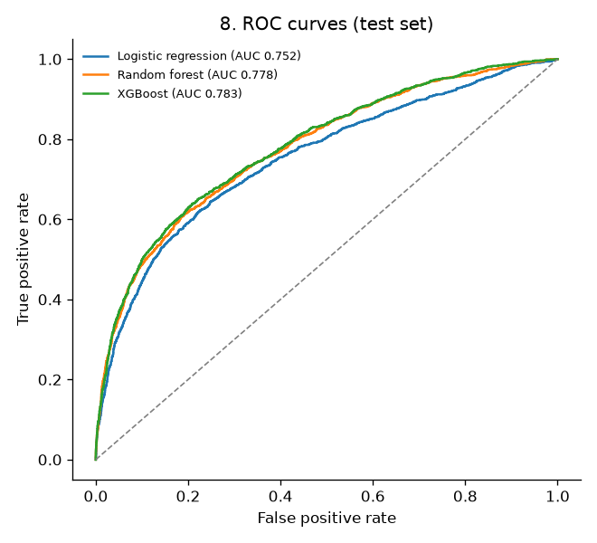
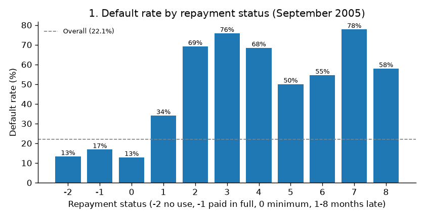

# Credit Risk: Predicting Credit Card Default

Machine learning models that predict whether a credit card client will **miss their next payment**, and turn the predictions into a **cost-based lending decision** that is checked for **fairness**.

**Author:** Ndou Fhumulani, BSc Honours in Applied Mathematics, University of Venda
**Paper:** [Credit Risk: Loan Default Prediction (PDF)](paper/Ndou_Fhumulani_Credit_Risk_Default_Prediction.pdf)
**Portfolio:** [ndoufhumulani.github.io](https://ndoufhumulani.github.io)

## Key results

Test set: **7,492 clients** (25%, never used in training).

| Model | AUC | Gini | KS | Brier | Recall at cut-off 0.17 |
| --- | --- | --- | --- | --- | --- |
| **XGBoost** | **0.783** | **0.565** | **0.430** | **0.134** | **0.744** |
| Random forest | 0.778 | 0.555 | 0.422 | 0.136 | 0.688 |
| Logistic regression | 0.752 | 0.504 | 0.396 | 0.141 | 0.677 |

- **XGBoost was the most accurate model**, 0.031 AUC better than logistic regression, the standard credit scoring model.
- At a **cost-based cut-off of 0.17** (a missed defaulter assumed to cost 5 times a rejected good client), XGBoost caught **74% of defaulters**, cut the default rate among approved clients from **22.1% to 10.1%**, and **halved the cost** of approving everyone.
- The **number of months with a late payment** was by far the strongest predictor.
- **Removing sex, age and marital status changed the AUC by only 0.0005**, and the model then treated men, women and age groups similarly.
- Full results: [`results/results.csv`](results/results.csv).

> **Caveat:** the data comes from one Taiwanese bank in 2005, and the error costs are assumed, so the project demonstrates the method rather than a model ready for use by a lender today.



## What the data shows

- **29,965 clients** after removing 35 duplicates; **22.1%** defaulted.
- Clients who paid on time defaulted 13–17% of the time; clients **two months late defaulted 69%** of the time.
- The default rate falls from **32%** for credit limits up to NT$50,000 to **11%** above NT$500,000.
- The six monthly bill amounts are almost identical (correlation 0.95), so logistic regression uses an L2 penalty.



## Method

1. **Cleaning** (`credit_risk.py`): remove the ID and duplicates, merge undocumented education and marital status codes into "other".
2. **Exploration** (`explore.py`): default rates by repayment status, credit limit, age, sex, education and marital status, plus correlations.
3. **Modelling** (`model.py`):
   - **Features:** credit utilisation, number of months late and average payment ratio, added to the 23 original variables.
   - **Split:** stratified 75/25, with defaulters weighted to handle class imbalance (probabilities corrected afterwards).
   - **Models:** logistic regression, random forest and XGBoost, tuned by 5-fold cross-validation on AUC.
   - **Evaluation:** AUC, Gini, KS, Brier score, precision, recall and calibration.
   - **Decision:** cost-minimising cut-off t\* = C<sub>FP</sub> / (C<sub>FP</sub> + C<sub>FN</sub>), tested for cost ratios of 3:1, 5:1 and 10:1.
   - **Fairness:** the best model retrained without sex, age and marital status, with approval rates and recall compared across groups.

## How to run it

```bash
git clone https://github.com/ndoufhumulani/credit-risk-default-prediction.git
cd credit-risk-default-prediction
python -m pip install -r requirements.txt
```

1. Download the data from the [UCI Machine Learning Repository](https://archive.ics.uci.edu/dataset/350/default+of+credit+card+clients) and put `default of credit card clients.xls` in the main folder.
2. Run the three scripts in order:

```bash
python credit_risk.py   # creates credit_risk.csv
python explore.py       # creates figures 01 to 07
python model.py         # creates results/ and figures 08 to 12 (about 5-10 minutes)
```

## Repository structure

```text
credit-risk-default-prediction/
├── credit_risk.py     data cleaning
├── explore.py         exploratory analysis
├── model.py           models, evaluation, cut-off and fairness
├── requirements.txt
├── figures/           charts used in the paper
├── results/           model comparison table
└── paper/             the full paper (PDF)
```

## Data source

I-Cheng Yeh and Che-hui Lien (2009), *Default of Credit Card Clients*, [UCI Machine Learning Repository](https://archive.ics.uci.edu/dataset/350/default+of+credit+card+clients), licensed under CC BY 4.0. The data is not included here; download it from the link above.

## Next steps

- Estimate the error costs from real lending losses and profits
- Explain individual predictions with SHAP values
- Apply the method to more recent or South African credit data
